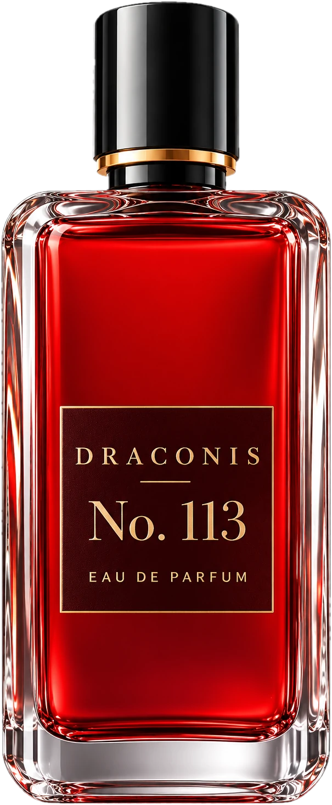
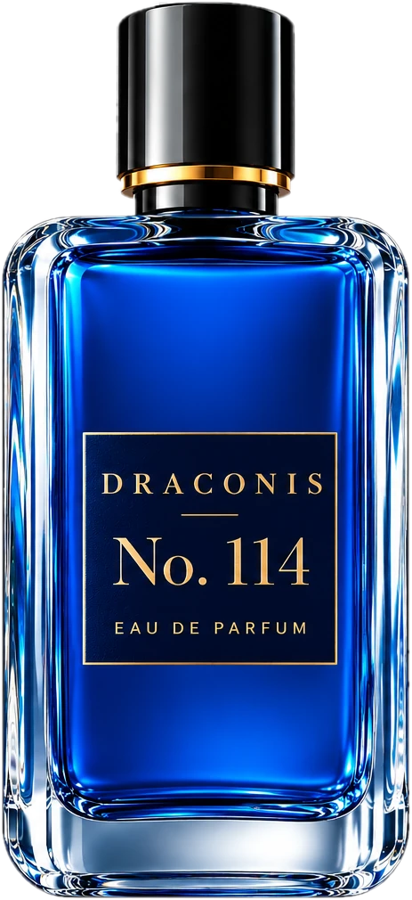
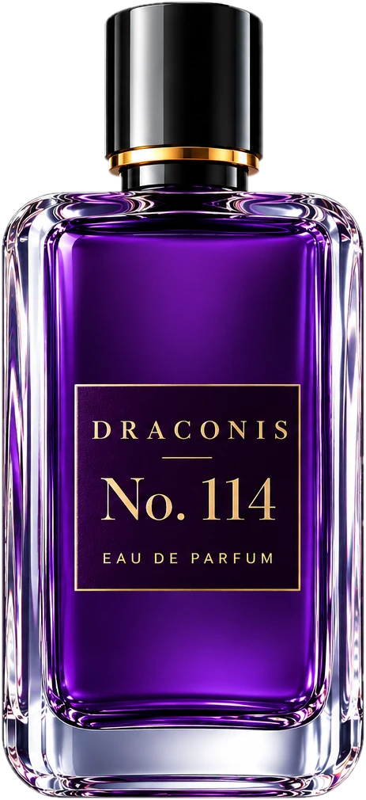

# Draconis · No. 113

**Bottled fire from the Flying Dragon.**
A scroll-driven landing page for a men's eau de parfum, staged inside a live WebGL nebula.

<p align="center">
  
  &nbsp;&nbsp;&nbsp;
  
  &nbsp;&nbsp;
  
</p>

---

## The idea

Sharpless 113 is a faint cloud of glowing hydrogen in Cygnus, south of the bright star Deneb, known to stargazers as the Flying Dragon. **No. 113** takes its number and its colour from it: the deep red of hydrogen light.

Its neighbour in the sky, Sh 2-114, has also been called the Flying Dragon. So the collection has a neighbour too: **No. 114**, in Cobalt and Violet editions.

The page is built like a short film. The bottle is the main character, the nebula is the set, and the scroll wheel is the camera.

## Scene by scene

| Scene | What happens |
| --- | --- |
| **Opening** | The DRACONIS wordmark gathers letter by letter, the nebula fades up, and the bottle rises out of the mist while a band of light sweeps across the glass. |
| **The name** | The camera dives into the brightest knot of the nebula. The bottle turns to one side and the story of the name holds on screen. |
| **Notes** | A pinned chapter in three stages (Top, Heart, Base). The sky regrades with each one: orange for *Ignition*, deep red for *The burn*, dark embers for the base. Each stage lifts away in the direction you scroll as the next rises in. |
| **The object** | The bottle leaves and a sideways strip moves through close-ups of the cap and collar, the glass and the label. Outlined words drift behind it at a slower speed, and each image moves inside its frame. |
| **No. 114** | The Cobalt and Violet bottles rise in one after the other, and the sky splits blue and violet behind them. Hover or tap a side to flood the sky with that edition's colour. |
| **Find it in the dark** | The sky goes black and the bottle with it. Your cursor becomes a warm lantern that lights both, leaving a glow that fades slowly where you've been. |
| **The collection** | Product cards rise in one after another. Each tilts in 3D and recolours the sky when you hover it, with a size switch, a counting price and a waitlist form. |

Every scene **arrives, holds and hands over**. Camera and colour moves happen in a window just before each scene lands; the scene then stays still while you read, marked by a sweep of light across the glass and a single glow in the sky.

## Interactions

- **Touchable fog.** A small simulation runs under the nebula. Move through the gas and it is pushed along, thins in your wake and drifts back into place over a few seconds.
- **Click or tap** to blow a puff through the fog.
- **Stars that notice you.** Stars detected in the photograph brighten softly when the cursor passes near them, and flare at random from time to time.
- **Scroll-reactive mist** that lags behind the scroll, billows and settles.
- **Bottles** that tilt toward the pointer and float gently while a scene holds.
- **Custom cursor** with magnetic pull on buttons, which turns into an ember in the dark.
- **Gold buttons**: a hairline rim with travelling light, a liquid-gold fill that spreads from where the cursor enters, and a four-point spark.
- **Idle dimming.** Leave the page alone for a few seconds and the sky slowly dims, waiting for your light.

## Responsive behaviour

- **Desktop and landscape tablets.** Side-by-side compositions. The bottle stays on one side through the origin and notes, and text columns never reach under it.
- **Phones and portrait tablets.** A layout of its own. Copy is pinned low in every scene, and the bottle is sized and centred in the space left above it, measured from the real text on the device. The wordmark sits fully readable above the bottle.
- **Phones on their side.** A compact side-by-side layout with a slim header.
- **Mobile menu.** A full-screen chapter menu in display type.
- **Touch.** Tapping replaces hovering; the shop cards recolour the sky as they cross the middle of the screen.

## Built with

| Part | How |
| --- | --- |
| Nebula | WebGL 1 fragment shader over the photograph: flow noise, bloom, star twinkle, colour regrading per chapter, a palette split for No. 114 and a lantern mode |
| Fog | A 160 px ping-pong framebuffer holding displacement, thinning and light, advected and relaxed every frame |
| Star flares | Stars found in the photograph at load (local maxima that stand out from their surroundings), then flared in the shader |
| Choreography | One GSAP 3.12.5 ScrollTrigger timeline built from scroll anchors, with eased transition windows and holds between them |
| Smooth scroll | Lenis 1.1.13 on desktop; native scrolling on touch |
| Type | Bodoni Moda (display), Hanken Grotesk (text), Cinzel (wordmark) |

## Files

```
draconis/
├── index.html         The whole page: markup, styles, shaders and choreography
├── nebula.jpg         Background photograph (Sh 2-113), 2048 px wide
├── b113.webp          No. 113 bottle, cut out
├── b114c.webp         No. 114 Cobalt bottle, cut out
├── b114v.webp         No. 114 Violet bottle, cut out
├── crop-collar.webp   Close-up: cap and gold collar
├── crop-glass.webp    Close-up: glass base
├── crop-label.webp    Close-up: No. 113 label
├── crop-114.webp      Close-up: No. 114 label
└── mist.webp          Seamless mist texture
```

## Run it

```bash
python3 -m http.server 8000
# open http://localhost:8000
```

Serve it over HTTP rather than opening the file directly. Browsers block `file://` images from WebGL, and the page would fall back to a still image.

## Make it yours

Everything lives in `index.html`:

- **Products and prices:** the `PRODUCTS` array
- **Camera and bottle positions per scene:** `POSE` (bottle) and `SH` (sky)
- **Copy:** the section markup
- **Colours:** the `:root` custom properties at the top of the stylesheet

## Accessibility and fallbacks

- `prefers-reduced-motion` turns off drifting, flares, smoothing and entrance animations; the scroll story still works.
- Text keeps strong contrast against the sky through soft scrims behind each block.
- All controls are keyboard reachable, with visible focus.
- Without WebGL the page shows the photograph as a still background instead of the live sky.

## Credits and notes

- **Concept content.** Fragrance notes, edition descriptions and prices are illustrative. The waitlist form does not send or store anything.
- **Background photograph.** Sh 2-113, the Flying Dragon Nebula. Add the photographer's credit here before publishing.
- **Bottle imagery.** Supplied for this concept.
